# HRIS Support Ticket Tracker

A small serverless API on AWS for logging and tracking HRIS support tickets. API Gateway takes the requests, a Lambda function handles them, and DynamoDB stores the tickets. A second Lambda sends me an email whenever a Critical ticket is created.

I built it to practice wiring AWS services together with Lambda, and I picked the ticket tracker because it is close to my day job. I work in HRIS technical support, so the fields (module, request type, priority, SLA due date) come from the kind of requests I deal with every week. All the data in this repo is made up.

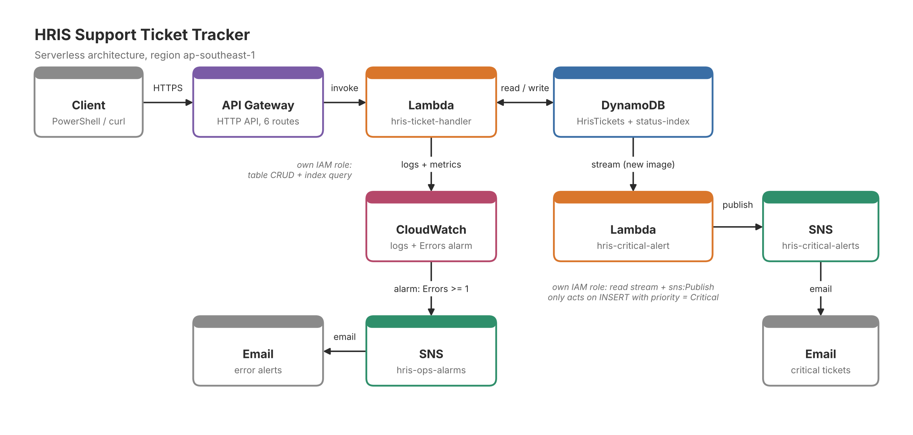

## What it does

You can create, read, update and delete tickets, filter them by status or module, and pull a summary of how many tickets sit in each status and module. Each ticket gets an SLA due date based on its priority. When a ticket is created with priority Critical, the alert Lambda publishes to an SNS topic and an email goes out.

| Method | Route | What it does |
|---|---|---|
| POST | `/tickets` | Create a ticket |
| GET | `/tickets` | List tickets, optional `?status=` and `?module=` filters |
| GET | `/tickets/{id}` | Get one ticket |
| PUT | `/tickets/{id}` | Update status, assignee, priority or resolution notes |
| DELETE | `/tickets/{id}` | Delete a ticket |
| GET | `/summary` | Ticket counts by status and by module |

## Services used

- **API Gateway (HTTP API)** for the routes. I used an HTTP API instead of a REST API because it is simpler and cheaper, and I did not need the extra features.
- **Lambda (Python 3.12)**, two functions: `hris-ticket-handler` for the API and `hris-critical-alert` for the alerts.
- **DynamoDB** with on-demand capacity, one table, and one global secondary index.
- **DynamoDB Streams** to pass new tickets to the alert function.
- **SNS** for the email alerts and for the CloudWatch alarm notifications.
- **CloudWatch** for logs and an error alarm.
- **IAM** for a separate, narrow role on each function.

## Data model

Table `HrisTickets`, partition key `ticketId` (string, for example `HRIS-70B503C7`).

| Field | Notes |
|---|---|
| customerName | Required |
| module | Core HR, Payroll, Time & Attendance, Recruitment, Performance, Learning, Reports, Other |
| requestType | Access/Permission, Issue/Bug, How-To, Data Correction, Enhancement |
| priority | Low, Medium, High, Critical (default Medium) |
| status | Open, In Progress, Waiting on Customer, Resolved, Closed |
| assignee | Defaults to Unassigned |
| description, resolutionNotes | Free text |
| createdAt, updatedAt, dueAt, resolvedAt | ISO timestamps in UTC |

The global secondary index `status-index` uses `status` as the partition key and `createdAt` as the sort key. Without it, filtering by status would mean scanning the whole table. With it, `GET /tickets?status=Open` is a query that returns the newest tickets first.

SLA due dates are calculated when the ticket is created:

| Priority | Due after |
|---|---|
| Critical | 4 hours |
| High | 8 hours |
| Medium | 24 hours |
| Low | 72 hours |

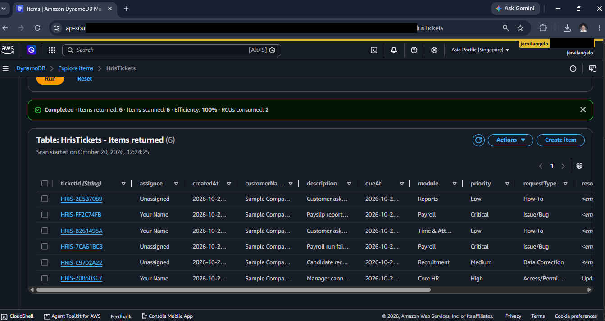
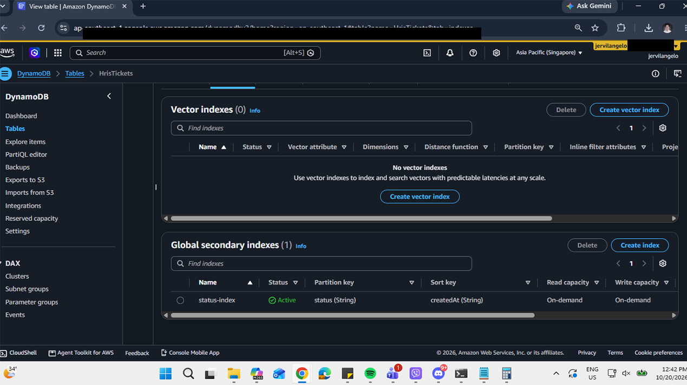

## Security

Each Lambda function has its own execution role, and neither one uses a wildcard on the resource.

`hris-ticket-handler` can only run PutItem, GetItem, UpdateItem, DeleteItem and Scan on the `HrisTickets` table, plus Query on the `status-index` index. `hris-critical-alert` can only read that table's stream and publish to the `hris-critical-alerts` topic. Both also have the basic CloudWatch Logs permissions that Lambda adds by default. The policies are in the `iam` folder with the account ID replaced by a placeholder.

The API also has a throttle of 5 requests per second with a burst of 10, mainly so a runaway script cannot run up a bill.

The API has no authentication. It was only up for testing and I did not leave it open. For anything real I would add a Cognito JWT authorizer.

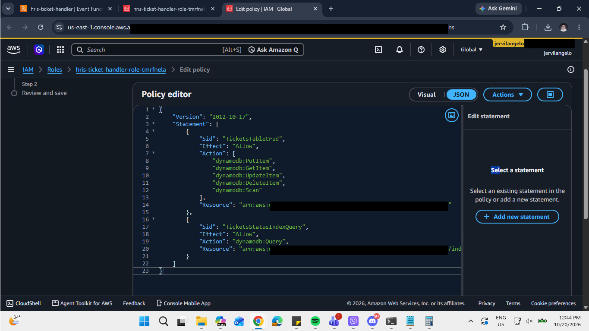
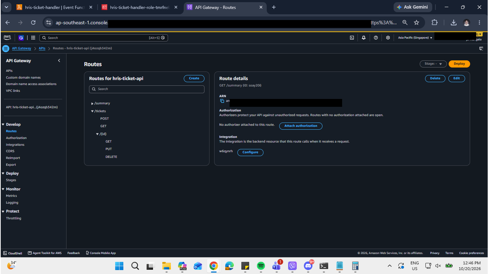
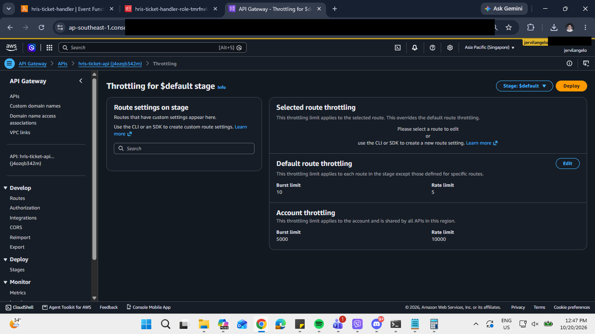

## Logging and monitoring

The handler writes a JSON log line for every request with the route and the Lambda request ID, and logs the error details when something fails. Log retention is set to one week on both functions. A CloudWatch alarm watches the `Errors` metric on the main function and emails me through SNS if there is at least one error in a five-minute window.

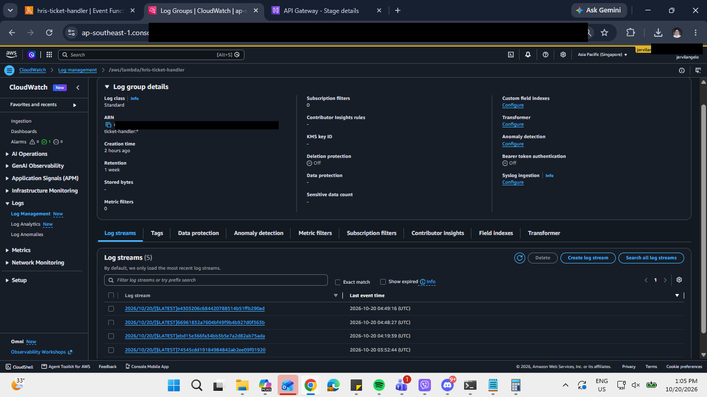
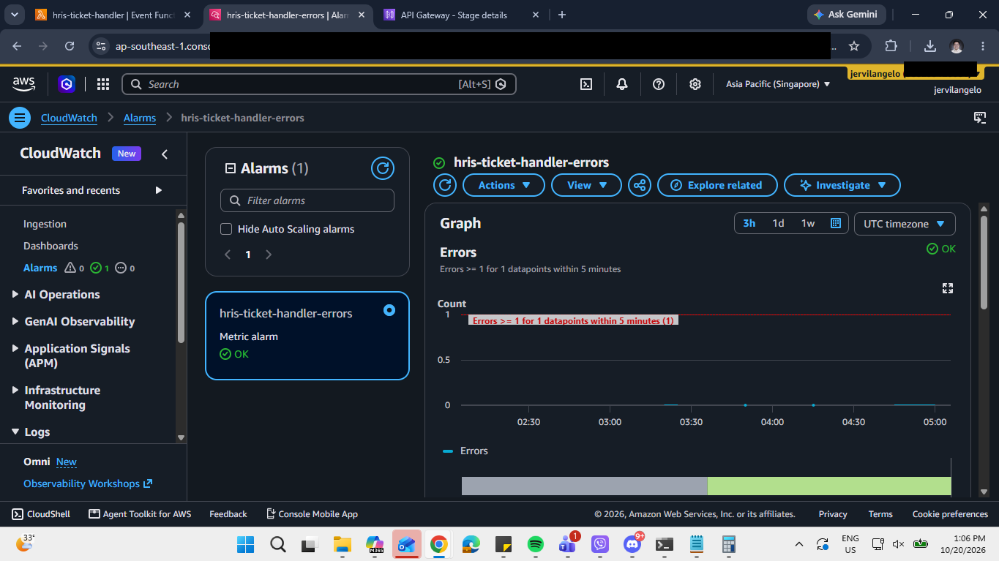

## Critical ticket alerts

Turning on DynamoDB Streams (new image) on the table lets a second Lambda see every change. That function only looks at inserts where the priority is Critical and ignores everything else, then publishes the ticket details to SNS.

I tested it both ways. Creating a Critical ticket produced an email within about a minute. Creating a Low ticket produced nothing.

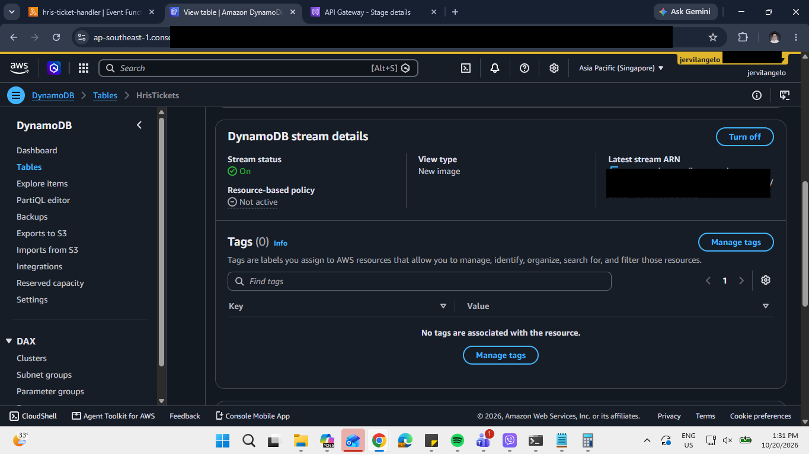
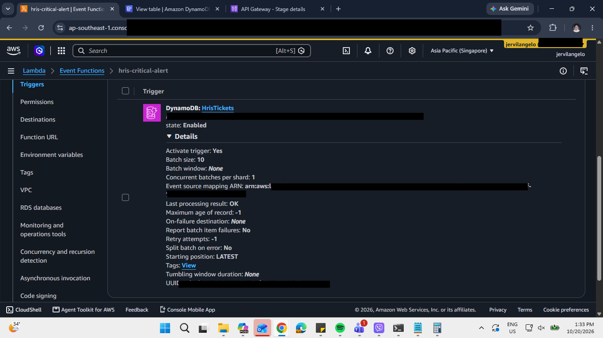
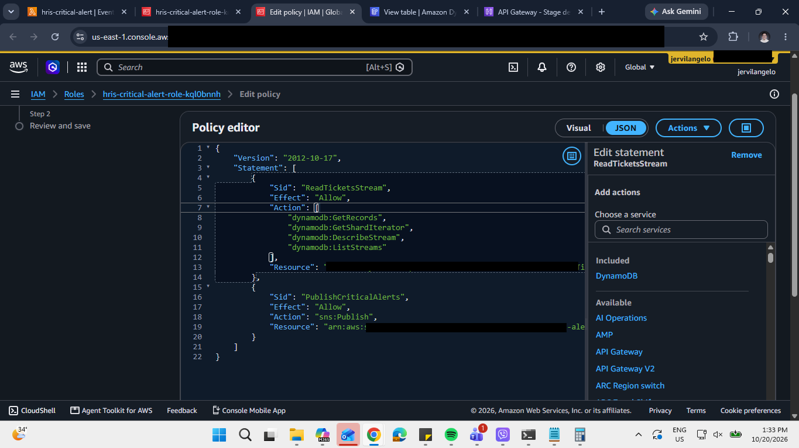
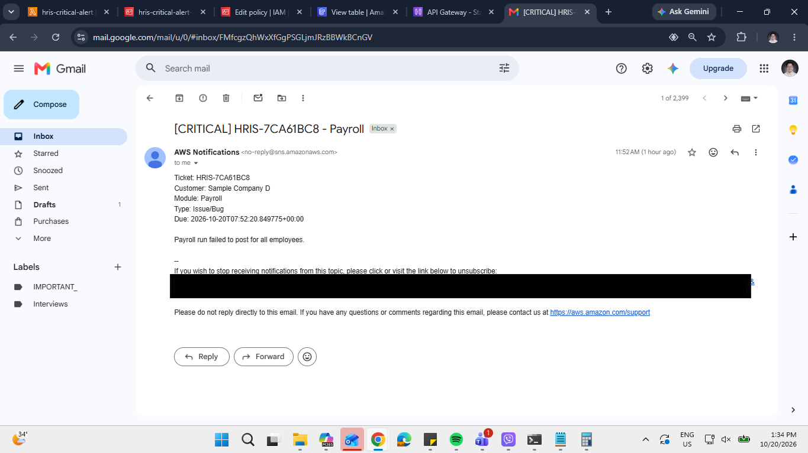
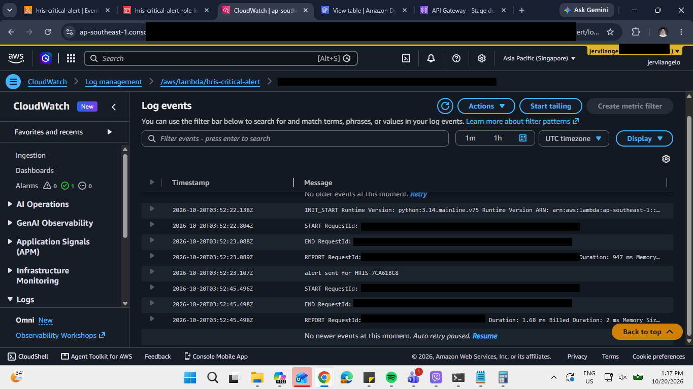

## Testing

I tested with PowerShell. The full set of commands is in `test-requests.ps1`. A few examples:

```powershell
$api = "https://YOUR-API-ID.execute-api.ap-southeast-1.amazonaws.com"

# create a ticket
Invoke-RestMethod -Method Post -Uri "$api/tickets" -ContentType "application/json" -Body '{
  "customerName": "Sample Company A",
  "module": "Core HR",
  "requestType": "Access/Permission",
  "priority": "High",
  "description": "Manager cannot view team records; needs role updated."
}'

# list open tickets
Invoke-RestMethod -Uri "$api/tickets?status=Open"

# resolve one
Invoke-RestMethod -Method Put -Uri "$api/tickets/HRIS-70B503C7" -ContentType "application/json" -Body '{"status":"Resolved","resolutionNotes":"Updated role permissions."}'
```

Things I checked: creating, reading, updating and deleting tickets; the status and module filters; the summary counts; a 400 with a list of validation errors when required fields are missing or a value is not allowed; a 404 for a ticket that does not exist; and the alert behavior described above.

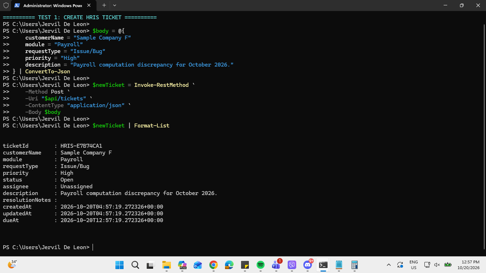
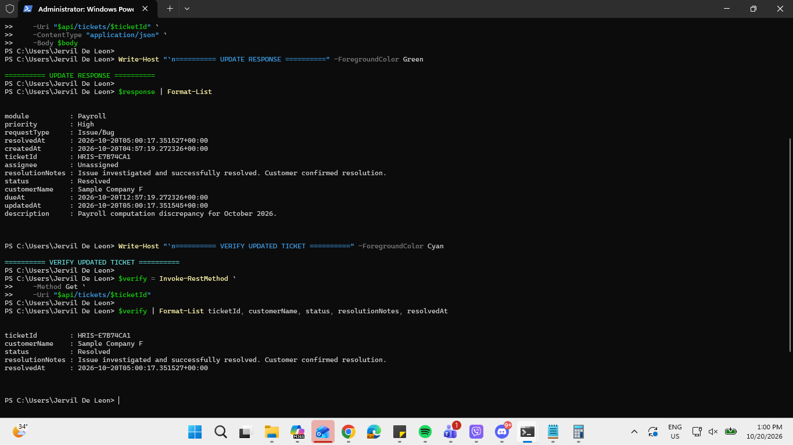
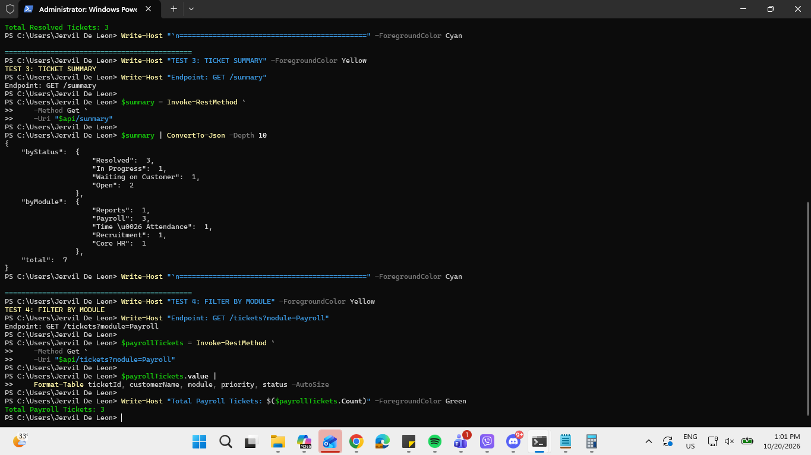
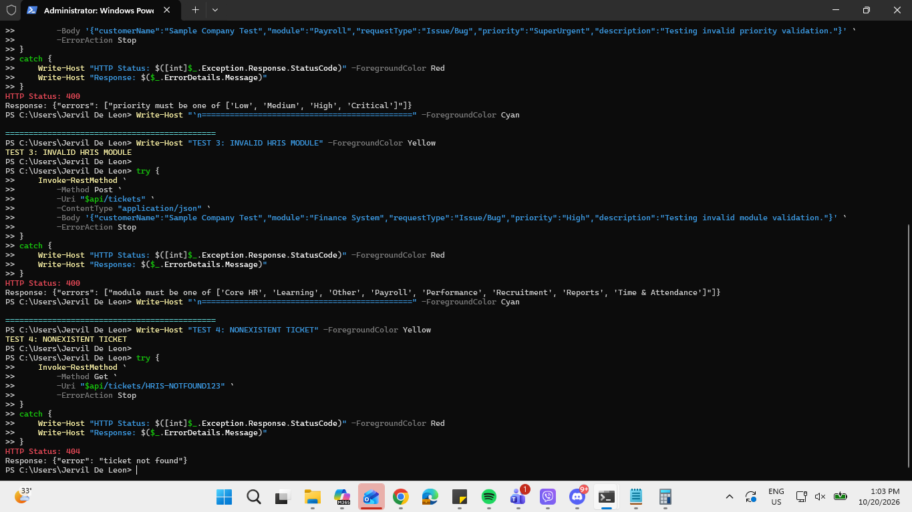

## Setting it up yourself

I built everything in the console in the `ap-southeast-1` (Singapore) region. In short:

1. Create the `HrisTickets` table (partition key `ticketId`, on-demand) and add the `status-index` GSI.
2. Create the `hris-ticket-handler` function (Python 3.12), set the environment variable `TABLE_NAME=HrisTickets`, paste in `lambda/ticket_handler.py`, and add an inline policy based on `iam/ticket-handler-policy.json`.
3. Create an HTTP API with the six routes above, all pointing at that function, with the `$default` stage and auto-deploy.
4. Turn on the table's stream with the new image view type.
5. Create an SNS topic named `hris-critical-alerts` and subscribe your email.
6. Create the `hris-critical-alert` function, set `TOPIC_ARN` to the topic's ARN, paste in `lambda/critical_alert.py`, add the policy from `iam/critical-alert-policy.json`, then add the DynamoDB stream trigger (batch size 10, starting position Latest).
7. Set log retention, add the error alarm, and set the API throttle.


## Limitations and what I would change

- No authentication yet, as mentioned above.
- `GET /tickets` without a status filter uses a Scan capped at 50 items. That is fine for a demo, but a real version would need pagination.
- The alert only fires when a ticket is created. If someone raises an existing ticket to Critical with a PUT, nothing is sent. Handling `MODIFY` events in the stream would fix that.
- Times are stored and emailed in UTC. Converting to local time would make the alerts easier to read.
- It is all clicked together in the console. I would like to redo it as an AWS SAM template so it deploys with one command.
- A small frontend page would make it nicer to demo.

## Repo layout

```
lambda/        ticket_handler.py, critical_alert.py
iam/           inline policies (account ID replaced with a placeholder)
docs/          architecture diagram and the PDF write-up
screenshots/   console and test screenshots used above
test-requests.ps1
```

## About

Built by Jervil Angelo De Leon. I work in HRIS technical support and this is one of my AWS practice projects.
